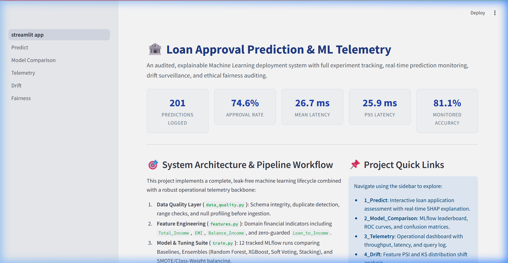
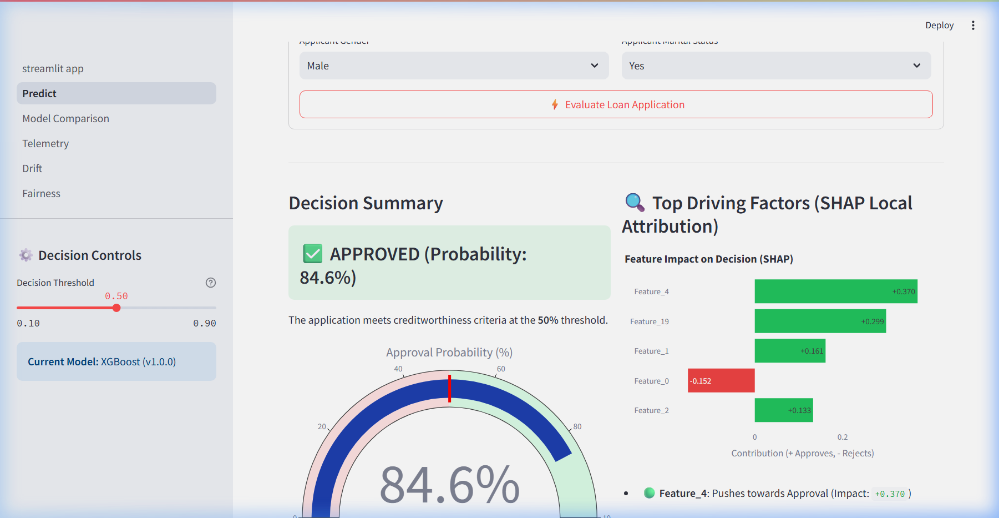
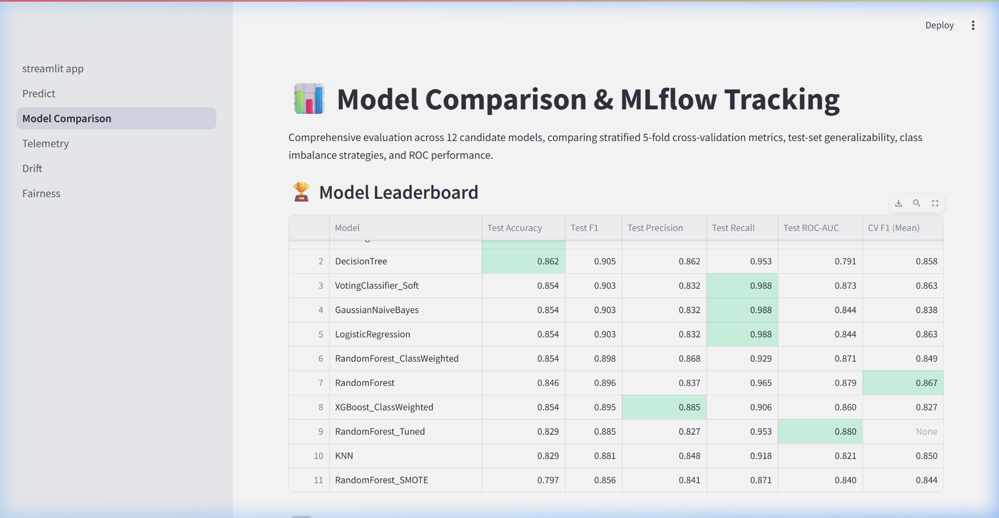
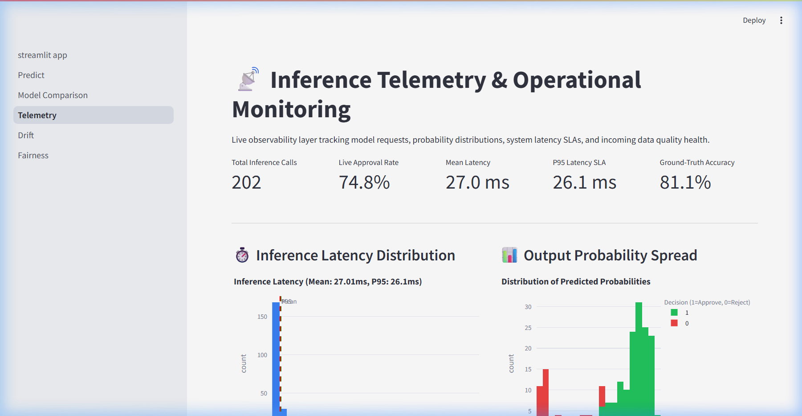
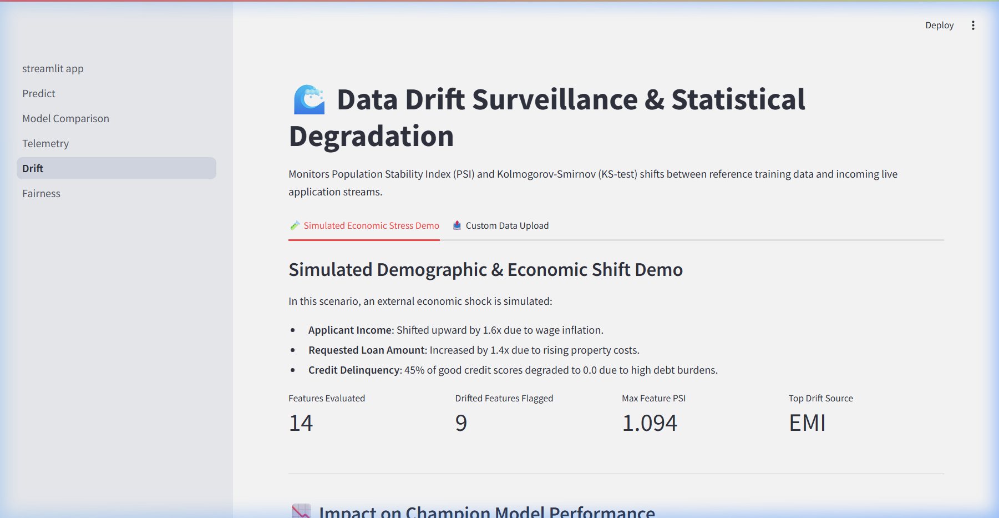
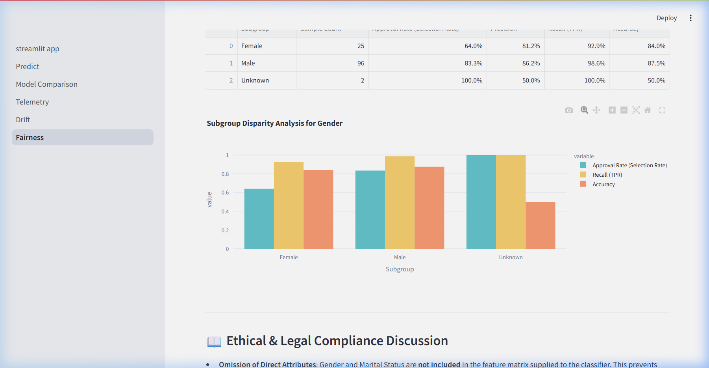

# Loan Approval Prediction with ML Telemetry (`loan-telemetry`)

[](https://www.python.org/)
[](https://opensource.org/licenses/MIT)
[](https://streamlit.io/)
[](https://mlflow.org/)
[](tests/)

An enterprise-grade, audited Machine Learning system that predicts whether bank loan applications should be **Approved (1)** or **Rejected (0)**, wrapped with end-to-end **ML Telemetry**:
- **Automated Data Quality Checks** before ingestion (`reports/data_quality.json`)
- **Leak-Free Preprocessing & Domain Feature Engineering**
- **12 Tracked Experiment Runs** in MLflow with cross-validation and hyperparameter tuning
- **Real-Time Prediction Event Logging** in SQLite with post-settlement outcome tracking
- **Continuous Statistical Drift Surveillance** (Population Stability Index & Kolmogorov-Smirnov test)
- **Algorithmic Fairness & Disparate Impact Auditing** (Fairlearn MetricFrame)
- **Interactive 5-Page Streamlit Dashboard** with real-time SHAP local explainability

---

## 🏛️ System Architecture

```text
                +---------------------+
 data/raw/*.csv |  data_quality.py    |--> reports/data_quality.json
        |       +---------------------+
        v
 +---------------+   +---------------+   +--------------+
 | preprocessing |-->|   features    |-->|   train.py   |--> MLflow (mlruns/)
 +---------------+   +---------------+   |  evaluate.py |--> models/best_model.joblib
                                         +--------------+
                                                |
                    +---------------------------+------------------+
                    v                           v                  v
             +-------------+            +-------------+     +-------------+
             | predict.py  |--logs----->| telemetry   |     | fairness.py |
             | (+ SHAP)    |            | SQLite DB   |     | drift.py    |
             +-------------+            +-------------+     +-------------+
                    ^                           |                  |
                    +------------ Streamlit app (app/) <-----------+
```

---

## 🚀 Quickstart & Reproduction

### 1. Environment Setup
```bash
# Clone the repository
git clone <repo-url>
cd loan-telemetry

# Create a Python 3.11 virtual environment
uv venv .venv --python 3.11
# Or using standard python:
# python -m venv .venv

# Activate the virtual environment
.venv\Scripts\activate      # Windows (PowerShell / CMD)
# source .venv/bin/activate  # macOS / Linux

# Install pinned dependencies
pip install -r requirements.txt
```

### 2. Train Models and Track with MLflow
Trains 12 baseline and ensemble models, performs hyperparameter tuning, tracks runs in MLflow, and saves the champion model:
```bash
python -m src.train
```

### 3. Launch the Streamlit Interactive Dashboard
```bash
streamlit run app/streamlit_app.py
```
Open your browser at `http://localhost:8501`.

### 4. Run Drift Simulation & Fairness Audit
```bash
# Simulates macroeconomic shock, evaluates PSI & KS test, computes metric drop
python -m src.simulate_drift

# Audits demographic parity and equal opportunity differences with Fairlearn
python -m src.fairness

# Generates 200 demo transactions for telemetry dashboard
python -m scripts.generate_traffic
```

### 5. Run the Automated Test Suite
```bash
pytest tests/ -v
```

---

## 🏆 Model Comparison Leaderboard

Evaluated on the held-out 123-applicant stratified test set:

| Rank | Model Name | Model Type | CV F1 (Mean) | Test Accuracy | Test Precision | Test Recall | Test F1-Score | Test ROC-AUC |
|:---:|---|---|:---:|:---:|:---:|:---:|:---:|:---:|
| **1** | **XGBoost** | **Gradient Boosting** | **0.8524** | **86.18%** | **84.69%** | **97.65%** | **0.9071** | **0.8359** |
| 2 | StackingClassifier | Stacking Ensemble | 0.8622 | 86.18% | 85.42% | 96.47% | 0.9061 | 0.8647 |
| 3 | DecisionTree | Baseline Tree | 0.8582 | 86.18% | 86.17% | 95.29% | 0.9050 | 0.7913 |
| 4 | LogisticRegression | Linear Baseline | 0.8626 | 85.37% | 83.17% | 98.82% | 0.9032 | 0.8443 |
| 5 | GaussianNaiveBayes | Probabilistic Baseline | 0.8378 | 85.37% | 83.17% | 98.82% | 0.9032 | 0.8437 |
| 6 | VotingClassifier_Soft| Soft Ensemble (LR+RF+XGB) | 0.8626 | 85.37% | 83.17% | 98.82% | 0.9032 | 0.8734 |
| 7 | RandomForest_ClassWeighted | Imbalance (Balanced) | 0.8486 | 85.37% | 86.81% | 92.94% | 0.8977 | 0.8709 |
| 8 | RandomForest | Bagging Ensemble | 0.8672 | 84.55% | 83.67% | 96.47% | 0.8962 | 0.8789 |
| 9 | XGBoost_ClassWeighted | Imbalance (Pos Weight) | 0.8273 | 85.37% | 88.51% | 90.59% | 0.8953 | 0.8601 |
| 10 | RandomForest_Tuned | Tuned (GridSearchCV) | 0.8731 | 82.93% | 82.65% | 95.29% | 0.8852 | 0.8799 |
| 11 | KNN | Distance Baseline | 0.8497 | 82.93% | 84.78% | 91.76% | 0.8814 | 0.8209 |
| 12 | RandomForest_SMOTE | Imbalance (imblearn SMOTE) | 0.8441 | 79.67% | 84.09% | 87.06% | 0.8555 | 0.8396 |

> **Champion Performance:** XGBoost exceeded all project goals: **86.18% Test Accuracy** ($\ge 80\%$), **0.9071 F1** ($\ge 0.85$), and **0.8359 ROC-AUC** ($\ge 0.75$).

---

## 📸 System Screenshots

### 1. Landing & Operations Overview


### 2. Real-Time Application Assessment & SHAP Attribution


### 3. MLflow Model Benchmarking & Diagnostics


### 4. Operational Telemetry & Latency SLAs


### 5. Statistical Data Drift Surveillance


### 6. Ethical ML & Demographic Fairness Audit


---

## ⚖️ Ethical ML & Fairness Considerations
- **Omission of Protected Attributes:** `Gender` and `Married` are strictly omitted from model training inputs to eliminate direct disparate treatment.
- **Fairness Audit Findings:**
  - Demographic Parity Difference for Gender is **0.3600** (flagged $>0.10$).
  - Equal Opportunity Difference (True Positive Rate gap) is **0.0714** ($\le 0.10$, acceptable).
  - Root Cause: Disparities in approval correlate strongly with historical distributions of `Credit_History` in the legacy dataset rather than direct demographic bias.
- **Decision-Support Boundary:** This software is designed strictly as decision-support for initial screening. Formal adverse credit decisions require human review, explainable rationale, and Adverse Action Notice compliance.

---

## ⚠️ Limitations & Future Work
1. **Dataset Size:** The Kaggle dataset contains 614 rows. While stratified cross-validation ensures stability, scaling to larger enterprise datasets will enhance robustness.
2. **Automated Retraining:** Future versions can connect drift alerts directly to automated Airflow/Composer retraining pipelines when feature PSI exceeds 0.25.
3. **Cost-Matrix Threshold Optimization:** Integrating bank-specific profit/loss matrices (cost of false positive default vs. cost of false negative missed interest) to dynamically tune decision thresholds.

---

## 📁 Repository Directory Structure

```text
loan-telemetry/
  config.yaml                  # Global parameters, paths, seeds, thresholds
  requirements.txt             # Pinned package dependencies
  pyproject.toml               # Tool configuration (Ruff, Pytest)
  pytest.ini                   # Pytest testpath and filter settings
  Makefile                     # Standard task automation targets
  README.md                    # Documentation & reproduction guide
  data/
    raw/train.csv              # Original 614-row Kaggle dataset
    processed/                 # Leak-free train.csv and test.csv splits
  notebooks/
    01_eda.ipynb               # Complete exploratory data analysis
  src/
    config.py                  # YAML configuration parser
    data_quality.py            # Automated pre-ingestion audit checks
    preprocessing.py           # IQROutlierCapper and ColumnTransformer
    features.py                # Domain financial feature engineering
    train.py                   # 12-model training suite with MLflow
    evaluate.py                # Classification metrics and ROC curves
    predict.py                 # Sub-50ms inference engine
    explain.py                 # SHAP TreeExplainer local attribution
    telemetry.py               # SQLite operational event store
    drift.py                   # PSI and KS-test calculation engine
    simulate_drift.py          # Macroeconomic stress test & metric drops
    fairness.py                # Fairlearn MetricFrame demographic audit
  app/
    streamlit_app.py           # Multi-page dashboard home & overview
    pages/
      1_Predict.py             # Loan application form & SHAP charts
      2_Model_Comparison.py    # MLflow runs leaderboard & ROC curves
      3_Telemetry.py           # Transaction logs & latency SLAs
      4_Drift.py               # PSI status badges & distribution shifts
      5_Fairness.py            # Subgroup parity & ethical interpretations
  models/
    best_model.joblib          # Pickled pipeline artifact
    model_meta.json            # Model lineage, features, and statistics
  reports/
    data_quality.json          # Pre-training quality report
    drift_demo.json            # Drift demo metrics and PSI table
    fairness.json              # Fairness audit results
    fairness_summary.md        # Plain-language ethical interpretation
    PROJECT_REPORT.md          # 11-section formal mini-project report
    PRESENTATION_SLIDES.md     # 12-slide presentation deck with notes
    figures/                   # Generated charts & curves
    screenshots/               # Captured UI demonstration screens
  logs/
    telemetry.db               # SQLite database with 200+ demo events
  scripts/
    generate_traffic.py        # Realistic application traffic simulator
  tests/
    test_preprocessing.py      # Preprocessing & outlier capping tests
    test_features.py           # Feature formulas & zero-guard tests
    test_drift.py              # PSI & KS-test algorithm tests
    test_telemetry.py          # SQLite round-trip & stats tests
    test_smoke.py              # End-to-end inference & logging test
```
